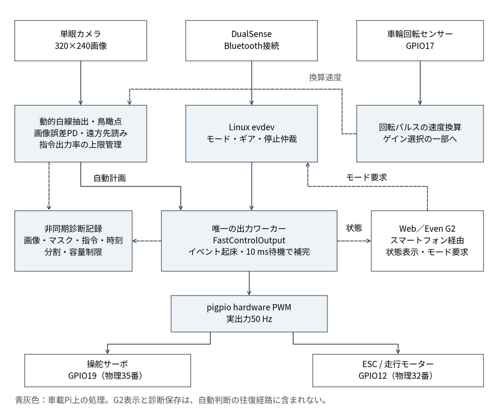
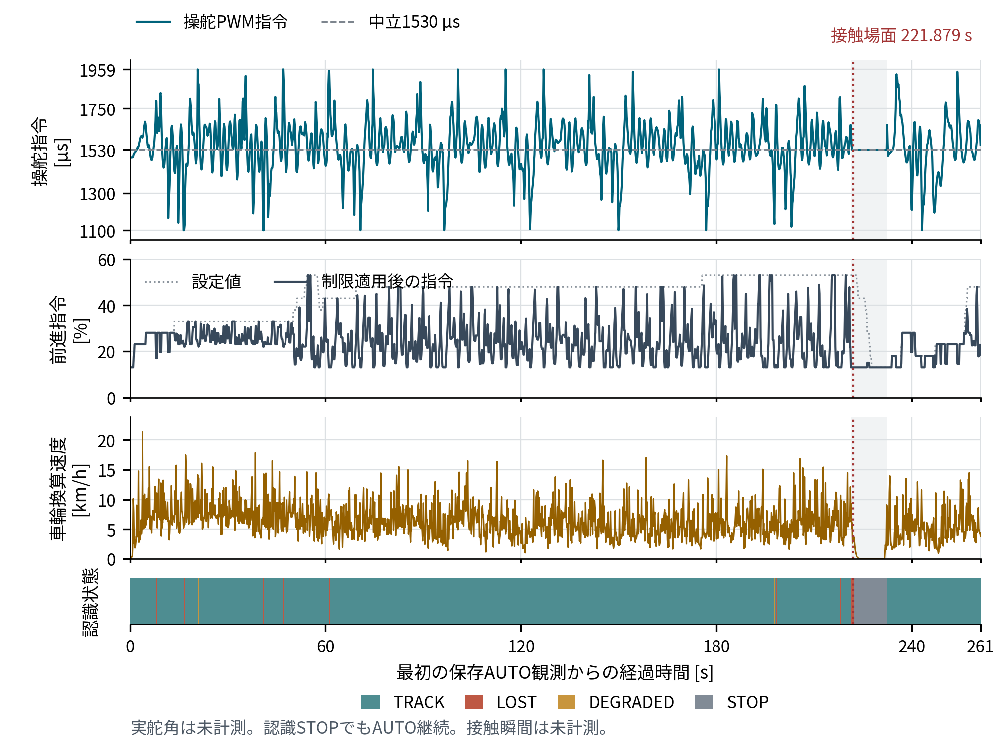
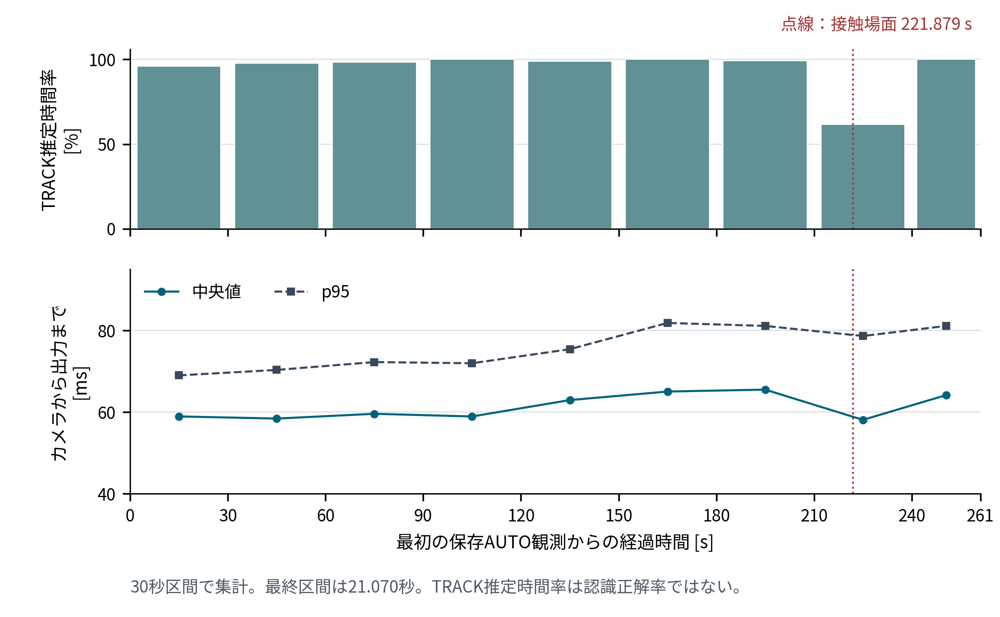
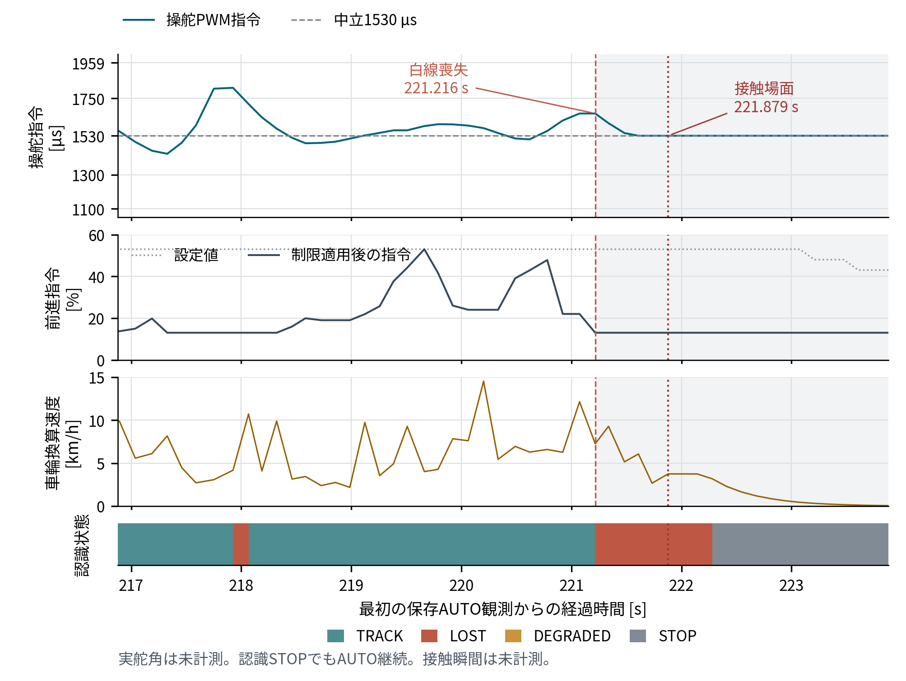
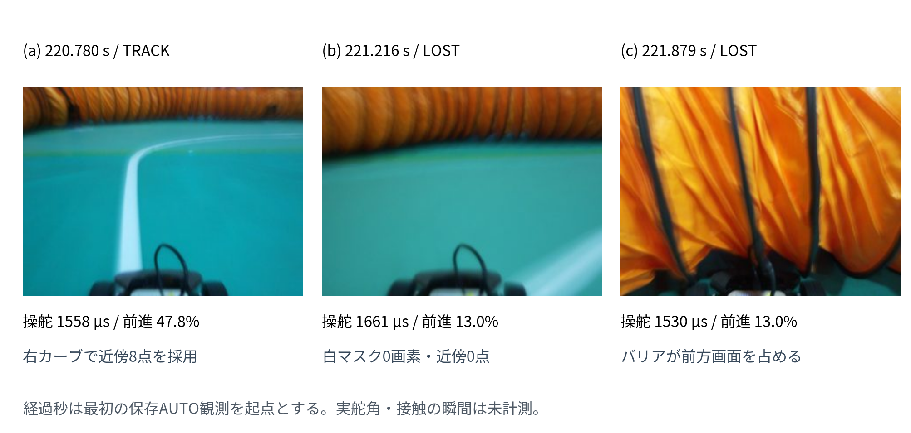
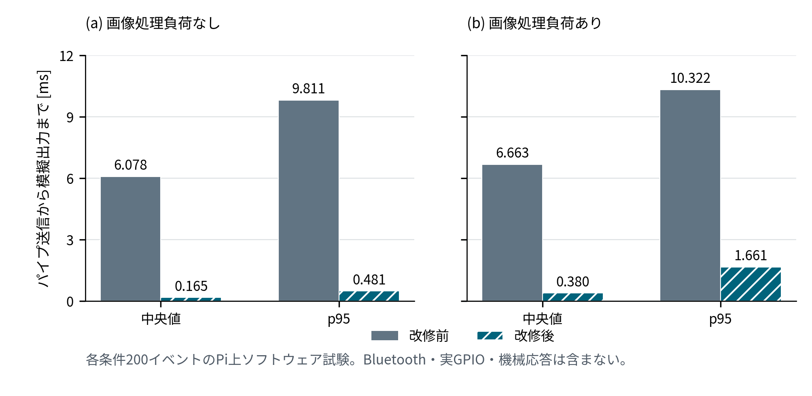
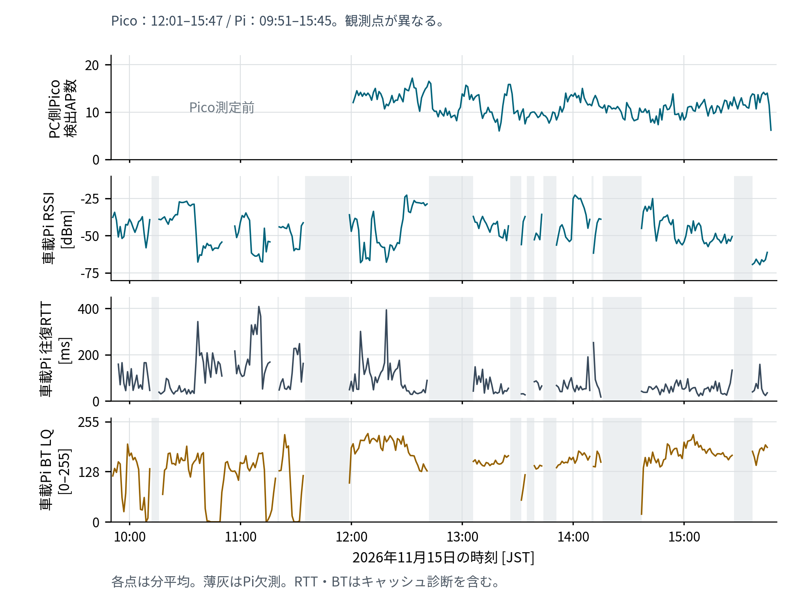

# 単眼白線追従による小型自動走行車の競技開発と記録に基づく失敗解析

## 第4回MAGPにおける認識・制御・操縦応答・無線診断の技術報告

NATC Tochigi／車両名 Monovision_2

著者・所属：[要確認]　大会日：2026年11月14～15日　技術報告初稿：2026年11月15日

### 要旨

本報告は、第4回ミニカー自動運転レースMAGPに向けて開発した、単眼画像による白線追従システムの実装と競技記録の分析を述べる。Raspberry Pi上で動的な白色候補抽出、画像座標の比例・微分制御、連結した遠方白線による操舵補助を行い、ゲームパッド入力と出力処理を画像認識から分離した。画像・認識状態・指令・処理時間・実装版を同一観測へ対応させ、有界容量で保存した。公式集計では予選1の非衝突連続3周・最速30.88秒に対し、予選2は8周・25.23秒であり、MAGP/RR統合予選7位で決勝へ進出した。決勝初戦敗退は参加者報告による。別途保存された約261秒の予選AUTO記録1973観測では、自己判定によるTRACKサンプル率は94.58%、画像からソフトウェア出力までの時間は中央値60.69 ms、95パーセンタイル78.23 msであった。開始約222秒後の接触場面では、近傍白線の抽出消失、操舵指令の中立復帰、前進指令の継続が確認された。実舵角・対地速度・車体位置は未測定であり、旋回応答不足と認識破綻の寄与は分離できない。競技成績と異なる種類の診断値を区別し、次回の比較実験と再解析に利用できる資料・スクリプト・執筆Skillを整備した。

キーワード：単眼画像、白線追従、PD制御、小型自動走行車、処理遅延、再現可能な失敗解析

## 1. 緒言

小型車両による自動走行競技では、画像認識と操舵制御の精度に加え、実環境の照明変化、操縦入力への応答、試験結果を追跡できる記録が走行の継続性を左右する。大会現場では調整と走行を短い周期で繰り返すため、画像を見失った原因、処理待ち、出力指令と実応答の違いを、目視だけで識別することは難しい。

第4回MAGPでは、予選の持ち時間を各4分とし、最大の非衝突連続周回数を優先し、同数の場合は最速ラップで順位を定めた。MAGP/RR統合クラスでは上位8チームが決勝トーナメントへ進出する[1]。したがって、瞬間的な最高速度だけでなく、認識と操作を継続できることが重要である。

本開発では既存の白線追従プログラムを基礎とし、太い白線や色かぶりへの適応、急曲線の先読み、操舵の振動抑制、手動入力と記録処理の分離を段階的に実施した。本報告の目的は、新たな制御理論の優位性を示すことではなく、競技で使用した版と観測データを照合し、実装・結果・原因仮説を再検証できる形で記述することである。

対象資料は、走行ソースの保存コピー、配備記録、元作業領域、回収された画像付き走行記録、ソフトウェア比較試験、無線診断、公式結果である。決勝初戦に対応する走行ログは同定できていないため、詳細な失敗解析は保存予選区間を対象とする。以降、記号E01～E12は付録Aの内部証拠を示す。

## 2. 自動走行システムの概要

### 2.1 競技条件と版の同定

公式資料は予選1と予選2それぞれの良い周回数・ラップを採用し、決勝を1対1、8周先行、開始位置を交換する3セット中2勝の形式としている[1]。掲載コース図は参考配置であり、実際のコース寸法・曲率・周長の実測資料は得られていない。提供された映像では青系の路面、白線、柔軟なバリアを確認できる。

保存主制御のSHA-256は `159b6996facdd74e151967fc76e5f408d61ad805f57245340c70a31a1157b398` である。保存25ファイルは11月15日10時31分の配備マニフェストと一致した。さらに、対象予選ログに記録された主制御と補助モジュールの計11ハッシュが保存版と一致した。ファイル名にcandidateを含む保存先であっても、少なくともこの予選で稼働した版と照合可能である。一方、決勝で同一版を使用したかは未照合である［E01、E02］。

元作業領域のGitにはコミットがなく、保存された3つのチェックポイント参照もコミットではなくtreeオブジェクトであった。このため、変更時期はコミット履歴からではなく、ファイルハッシュ、改修前コピー、配備記録から整理した。元作業領域の主制御は別の旧系列であり、最新の保存予選版と同一とは扱わない［E03］。

### 2.2 ハードウェアとソフトウェア

車載Raspberry Piが画像処理、運転モードの仲裁、GPIO出力を担う。画像は320×240画素で取得し、回転補正後に処理する。Python、NumPy、OpenCV、Picamera2、pigpioを用い、Linux入力デバイスを標準ライブラリで読み取る。実機のPi・カメラの型番と、OS・各ライブラリの導入版は[要確認]である。参照した現行文書の版を実機版と読み替えない。

表1　保存予選版の主要な入出力設定。番号はBCM GPIOであり、物理ピン番号を併記する。

|対象|設定・役割|評価上の注意|
|---|---|---|
|カメラ|320×240画素、同一リクエストの画像と時刻情報|撮影姿勢・レンズ・実距離は未校正|
|操舵サーボ|GPIO19／物理35番、50 Hz、中立1530 µs|PWM指令は実舵角ではない|
|ESC|GPIO12／物理32番、50 Hz、中立1531 µs、前進端1059 µs|TBLE-04S使用の記録。モーター型番は未確認|
|車輪回転センサー|GPIO17／物理11番、立上りパルス|車輪径0.06 m、36パルス/回転は設定値|
|DualSense|左スティック操舵、R2駆動、L2制動|無線伝送を含む総合遅延は別の測定量|
|Web・Even G2|状態表示、モード要求、指令理由の確認|通常の画像認識はPi内で完結する|
|Pico 2 W|ノートPC側の周辺Wi-Fi観測|保存予選版の操舵・駆動出力経路には用いない|

サーボ・ESCとPiは共通GNDを必要とする。配線試験では共通GND接続後に操舵が回復したとの記録があるが、当日の全配線をコードから証明することはできない。既存のGPIO13案やPico経由試験と、表1の予選版を区別する［E01、E04］。

## 3. 走行アルゴリズムと実装

### 3.1 動的白線抽出と経路点

白線候補の抽出では、HLSの明度とHSVの彩度を利用する。色成分の範囲指定、モルフォロジー、四点対応の射影変換はOpenCVの標準機能を用いる[3-5]。ここで述べる床統計や候補選別条件はプロジェクトの実装であり、標準関数の説明と混同しない。

関心領域は元画像の35行目から200行目未満とする。明度の50パーセンタイルを床代表値F、99パーセンタイル等から求める白線参照をRとし、S=max(0,R−F)から閾値を定める。実装上の主な関係は次式である。

    T_L = clip(F + max(5, 0.45S), 20, 245)
    T_Δ = clip(0.08S, 3, 10)

明度条件に加え、31×31ガウシアン平滑画像との差および色条件から種画素を作る。十分明るい種間を補い、3×3クロージングを施す。基本の低彩度条件に加え、床側の支持が十分ある場合に限り、床に対して明るく彩度の低い画素も許す。これは照明色の影響を受けた白線を扱う規則であり、学習済み意味セグメンテーションではない［E05］。

候補マスクを鳥瞰画像へ変換し、近傍ヒストグラムから探索を始める。縦方向8段の窓について白画素数、幅、予測位置、前フレームとのずれ、窓間連続性を評価し、下から上へ点列を得る。3点以上を採用した場合の信頼度は支持点数から構成した指標であり、正解確率として校正していない。鳥瞰変換の対応点は画素単位であり、地面上のメートル座標への校正でもない［E01、E05］。

### 3.2 画像座標PD制御と先読み補助

経路点の線形補間と二次近似を混合し、制御点の横座標と画像中心160との差を誤差e[px]とする。基礎操舵の論理値u₀は、誤差処理後のe_u、平滑化した差分d_f、点列近似の勾配h、形状倍率gを用いて次の形で計算する。

    u₀ = 10 + g(K_P e_u + K_D d_f + 0.085h)
    d_k = clip((e_u,k − e_u,k−1)(1/30)/Δt, −18, 18)

差分は基準周期1/30秒で正規化し、フレーム間隔Δtに応じて平滑化する。Δtは実装上0.005～0.30秒に制限し、不正値は基準周期へ置換する。hは物理的接線角ではなく、点列インデックスに対する二次近似の微分である。K_Pは低出力側0.025から高出力側0.010へ移行し、K_Dは0.10とする。微分のノイズ増幅を抑えるため平滑化を用いる説明は文献[6]と整合するが、本実装のゲインや時間正規化を連続時間PDの係数としてそのまま移植することはできない。

保存予選版は基礎制御点の鳥瞰y=116を優先する。さらに、近傍白線と同一の連結成分をカメラマスク上で確認して遠方観測を延長し、近遠の位置・接線差を補助操舵へ用いる。追加補助は出力指令28～48%で強くし、通常上限0.40、十分な支持をもつ急曲線で最大1.00の論理値とする。操舵範囲、変化率、移動平均による平滑化を併用する［E06］。

したがって、速度に応じてメートル単位の追従距離を延長する標準Pure Pursuitや、地図上の横偏差を用いるStanleyではない。高出力時にも遠方の画像情報を利用するが、実速度に応じた物理的な予見時間を一定にする設計ではない。後述する別系列のPure Pursuit実装とも区別する。

### 3.3 前進指令、喪失時動作、回転換算

AUTOの設定値13～100%は、中立から前進端までを正規化した指令率である。経路の近遠接線差、方向、横ずれ、操舵余裕に応じて出力上限を定める。遠方まで直線を支持した場合は上限解除を早め、遠方で曲がる場合は短い直線だけで加速しないよう制限する。校正済み車速目標へ追従する閉ループ速度制御ではない［E07］。

白線喪失時は直前の信頼できる操舵を短期間保持した後、弱い候補から新しい旋回方向を作らず中立へ戻す。保持3フレームと中立復帰の一部はフレーム数に基づくため、一定の実時間は保証されない。参加者が停止を判断する運用要求により、長時間喪失でもAUTOと最低13%の前進指令を維持する実装がある。内部の知覚状態STOPは、運転者が選ぶ停止モードとは異なる。この動作を自動安全停止と記述してはならない［E01、E07］。

回転パルス周波数fから、設定車輪径Dと1回転パルス数Nによりv=fπD/Nを計算し、平滑化した車輪換算速度を得る。実舵角・対地速度・絶対位置は測定していない。表示用の自転車モデル積分は指令舵角を仮定するため、実軌跡や自己位置推定の精度評価には使用しない。

### 3.4 操縦・出力・記録の分離

ゲームパッドの軸値はLinuxのSYN_REPORT境界でまとめ、同一レポートの途中状態を出力しない。緊急停止は境界を待たず受け付ける。Linux入力が値の変化を通知する方式であること[7]に対応し、変化のない保持操作と通信断の判定を分離した。ただし読取処理が生存していることだけでBluetoothの到達性を保証できるわけではない。

出力ワーカーは認識と独立した唯一の書込者であり、入力またはAUTO計画変更のイベントで起床する。モードの世代番号を照合し、新しい手動・停止選択を古いAUTO計画が上書きすることを防ぐ。10 msの定期確認と、pigpioによる50 Hzの物理PWM設定[8]は異なる周期である［E08］。

カメラ画像と時刻情報は同一のPicamera2リクエストから取得する[9]。診断保存では画像、マスク、経路点、状態、受理指令、処理時間、ビルドハッシュを同じ観測へ対応させる。保存容量と分割数には上限を設け、描画を最新1件の待機へ、ZIP等の確定を別プロセスへ分離する。保存対象は全制御フレームではない［E09］。

## 4. 競技に向けた開発と調整

### 4.1 継承部分と今回の改善

既存基準版は白線点列、制御点、画像誤差による操舵、回転換算等を含む。保存基準版との定義単位の比較では39定義が同一、21定義が変更、15定義が追加された。ただし、この同一性は当該保存版との関係を示すものであり、初期提供原本との完全一致やコードの発明者を証明しない。由来注記のハッシュに一致する初期原本は未確認である［E03］。

表2　主な改修と、保存資料で確認できる検証の範囲。

|時期|改修|確認できる範囲|
|---|---|---|
|11月13日|動的明度、太線・色かぶり、喪失時操舵|保存映像・合成照明の再処理。完走率比較ではない|
|11月14日|同一フレーム診断、実Δt補正、非同期描画|画像と指令の対応、停止時・オフライン試験|
|11月14日|記録確定の別プロセス化、手動出力の分離|同一保存画像負荷・模擬入力/出力の処理時間|
|11月14～15日|連結遠方観測、急曲線の補助、直線上限解除|保存観測の再生。実ラップ短縮の対照試験はない|
|11月15日|入力変更による出力ワーカー起床、レポート単位の仲裁|各条件200イベントのソフトウェア比較|
|11月15日|直線へ戻る条件に限る小さな戻し補助|テストと配備確認。物理的な追従改善は未検証|

振動抑制では反応の鈍化を訴える試走結果もあり、一部の試作はロールバックした。保存されたモジュールが存在することと、最終版で呼び出されることは同義ではない。例えばstraight_damping.pyは保存されるが対象予選の主制御からは読み込まれない。改修の一覧をそのまま最終採用技術の一覧にしない。

### 4.2 探索的な別系列

元作業領域には、局所占有表現、視覚オドメトリ、追い抜き計画、Pure Pursuitを含む別系列がある。追従曲率をκ=2x/(x²+z²)とする実装は文献[12]の幾何的追従の説明対象となる。しかし、保存資料は中立出力のshadow試験と模擬的な通過を区別し、実車での校正・追い抜き成功を確定していない。対象予選版にはこれらの制御モジュールの呼出しがないため、競技成績をこれらの成果として扱わない［E03］。

## 5. 競技結果

### 5.1 公式成績と観測範囲

公式サイトのトーナメント図およびリンク先集計表による成績を表3に示す[1,2]。HTML本文の予選2表は最終集計と異なるため、更新された集計表の該当行とトーナメント図を照合した。7位はMAGP/RR統合の予選順位である。決勝初戦敗退は参加者本人の報告であり、最終総合順位、対戦のセットスコア、決勝走行ログは未確認である。

表3　NATC Tochigiの公式予選成績。保存ログから推定した周回数ではない。

|区分|最大非衝突連続周回数|最速ラップ|
|---|---:|---:|
|予選1|3周|30.88秒|
|予選2|8周|25.23秒|

条件を揃えた比較試験ではないため、Q1からQ2の差を特定改修の効果へ割り当てない。また、以下の261秒AUTO記録の開始・終了と公式計時の開始・終了を対応させるマーカーはない。261秒を8周で割って平均ラップとする計算は行わない。

### 5.2 保存予選区間の定量評価

調査できた保存資料は38セッション、重複除外後13987観測であった。これらは全試行の網羅的な台帳ではなく、認識試験や部分記録を含むため、走行成功率の分母には使用しない。詳細対象は2026年11月15日11:28:38.627～11:32:59.697 JSTの画像付き予選記録であり、1973観測、261.070秒である［E02、E10］。

表4　予選記録の保存観測に基づく集計。p95は線形補間による95パーセンタイルである。

|指標|値|定義・限界|
|---|---:|---|
|TRACK観測|1866件、94.58%|自己判定状態のサンプル率。正解率ではない|
|LOST／DEGRADED／知覚STOP|28／3／76件|運転者の運転モードとは別|
|TRACK推定時間率|94.54%|次の保存観測まで左端保持。最後の点に時間を付与しない|
|画像からソフトウェア出力まで|中央値60.69 ms、p95 78.23 ms|PWM位相・アクチュエータ応答は含まない|
|画像認識処理|中央値36.04 ms、p95 47.97 ms|保存観測に対応した処理時間|
|制御フレーム間隔|中央値65.20 ms|保存画像間隔とは別|
|保存画像間隔|中央値133.01 ms|約7.5 Hz相当。全制御フレームを保存していない|

状態推定時間率は、保存間隔が1秒以下の点について状態を次観測まで左端保持して算出した。対象区間に1秒超の保存欠測はなかった。TRACK時の画像誤差は画素値として取得できるが、物理的な横偏差や認識正解ラベルではない。異なる保存セッション間で同じ時刻・処理フレーム番号を重複除外し、内容競合は0件であった。

### 5.3 全体傾向と接触場面

0～60、60～120、120～180、180～210秒のTRACKサンプル率は、それぞれ96.94、99.14、99.56、99.09%であった。少なくともこの集計は、時間経過に従って認識状態が単調に悪化したという説明を支持しない。接触直前3秒の画像から出力までの時間は中央値66.57 ms、p95 84.85 msであり、保存された観測では、接触直前だけに長時間の処理停止を示す値は確認できなかった。ただし全制御フレームと実機応答を記録したものではなく、計算・出力・機構の寄与は分離できない［E10］。

最初の保存AUTO観測から221.216秒のフレーム341で、近傍点が0となり、保存白線マスクの非ゼロ画素も0となった。操舵指令は直前1661 µsから221.609秒には1530 µsの中立へ戻った一方、前進指令は13%を維持した。221.879秒のフレーム346ではバリアが画面を占め、以後9.659秒間の保存観測で車輪パルス数が一定であった。画像とパルスの両方が接触・スタックとの解釈を支持するが、力学的な接触瞬間をミリ秒精度で測ったものではない［E10］。

232.462秒ではTRACKへ復帰した。したがって、261秒の全記録は接触後の停止相当区間と復帰走行を含む。最終保存画像も白線を検出しているため、その時刻を別の衝突瞬間とする根拠はない。

### 5.4 手動応答のソフトウェア比較

入力形式のイベントをパイプから注入し、模擬出力先が更新されるまでをPi上で比較した。各条件200イベントであり、画像負荷なしのp95は9.811 msから0.481 msへ、保存画像の認識負荷ありでは10.322 msから1.661 msへ変化した。図6は中央値とp95を示す［E08、E11］。

この比較は定期確認だけに依存しない処理分離の効果を、当該模擬条件で支持する。各条件で画像処理回数が異なり、独立反復の分散や信頼区間は得られていない。会場の電波条件下で同じ比率の改善が得られるとは主張しない。

### 5.5 Wi-Fi・Bluetoothの大会中観測

PC接続Picoの周辺AP走査は12:01～15:47の1360スキャン、車載Piの診断は09:51～15:45の7297スナップショットであった。Piは自身の355分範囲内で102分の欠測がある。18時までの連続測定ではなく、保存済みの範囲を分析した。PicoのAP検出数は1回あたり平均11.4、範囲2～20であり、観測場所は車両と同一ではない［E12］。

接続先Wi-Fiの受信強度は−75～−18 dBm、デフォルトゲートウェイへのICMP往復応答の分平均最大は11:10の408.5 msであった。受信強度は接続先の距離や干渉電力そのものではない[10]。Bluetoothでは品質指標0～255とAFH有効候補数20～57を記録し、10:44～10:48には分平均品質0、有効候補20であった。品質値を通信成功率へ、Classic RSSIを絶対dBmへ、AFH候補数を実際の電波占有率へ換算しない[11]。

両観測がある152分ではAP検出数と往復応答の分平均の相関は約0.135であり、多数APの検出だけで遅い応答を説明できなかった。キャッシュ値の繰返しを含むため独立な試行ではない。PC自身の通信、測定位置・姿勢も交絡要因の候補であるが、それぞれの寄与は分離していない。これらは会場無線の変動を残す診断であり、予選接触や手動遅延を他チームの混線が引き起こしたとの証明ではない。

## 6. 考察

### 6.1 継続走行と局所的な認識破綻

公式結果は非衝突連続8周と決勝進出を示し、保存区間の大部分ではTRACK状態が継続していた。一方、長時間の継続と、特定カーブで追従を失うことは両立する。今回の記録が示す課題は、保存観測においてカーブ付近へ局在した破綻である。カーブ接近に伴う観測条件の変化と、喪失後の回復動作を検討する必要がある。

遠方には曲がる白線が観測されていたが、近傍抽出が消失すると、補助操舵を支える近傍アンカーも失われる。白線が関心領域の右下へ移動したこと、明度・色条件の変化、実際の旋回応答不足は原因候補である。画像だけではどれが支配的かを決められない。遠方の観測範囲を広げるだけでなく、近傍から遠方まで同じ対象を追う支持条件を、失敗画像で評価する必要がある。

また、喪失後に舵を中立へ戻しつつ前進を続ける方策は、弱い候補による逆向き操舵を避ける一方、旋回途中の回復を難しくする可能性がある。これは当時の運用要求への実装であり、一般に適切な喪失時方策が証明されたという意味ではない。停止・減速・短時間予測保持などの候補は、別の比較試験として評価すべきである。

### 6.2 先読み、平滑化、実応答の整合

速度を上げた際に必要な先読みは、画像でどこまで見えるかと、操舵がいつ車体へ作用するかの両方で決まる。対象版では基礎制御点が固定優先であり、追加先読みの強さは主に出力指令に依存する。車輪換算速度と出力指令の対応は路面、電池、曲がり、空転で変わり得るため、速度に比例した実距離の先読みを行っているとはいえない。

反応を滑らかにするための平滑化、レート制限、微分制限を重ねると、振動抑制と旋回開始の遅れが競合する。保存指令と画像の時系列だけでは、機構の追従が不足したのか、指令自体が遅いのかを分離できない。次回は実舵角または車体姿勢を測り、カメラ時刻、受理指令、物理応答を同じ時計へ対応させることを優先する。

### 6.3 手動応答と無線観測の位置付け

独立したイベント駆動出力は、画像処理待ちや入力レポート途中の状態を減らすソフトウェア構造として有効であった。しかし、ソフトウェア待ち、無線受信、PWM位相、サーボの機械応答は異なる区間である。会場で体感した操作遅延を説明するには、DualSenseの基準入力時刻から実応答までを直接測り、USBとBluetooth、解析通信の有無、位置をそろえて比較する必要がある。

AP数やAFH診断だけでは、どの送信源が何秒の制御遅延を生んだかは求められない。欠測とキャッシュを保持した今回の記録は、悪化した時間帯と追加検証候補の抽出に利用できる。今後は車両と同じ観測点で、対応機器による電波使用時間・再送回数を取得する設計が望ましい。

### 6.4 評価の限界と次回の優先事項

本報告は保存された単一の詳細予選区間と、条件の異なる開発試験を扱う。未保存の試行を含む成功率、地図上の実軌跡、物理横偏差、障害物回避成功率、決勝の失敗原因は算出していない。公式成績の変化も、路面・照明・走行条件をそろえたアルゴリズム比較ではない。

次回は、競技段階・車両・開始終了・ソースハッシュ・公式記録を結ぶ実験台帳を設ける。その上で、同じコース・設定・照明で、認識条件、先読み、喪失時方策を一つずつ比較する。全試行と成功判定を保存し、校正済み速度と実応答を追加することで、今回の仮説を性能比較へ進められる。

## 7. 結言

単眼白線追従車両の競技開発について、動的白線抽出、画像座標PDと遠方補助、手動入出力・記録の処理分離、および実装版と観測の対応を整理した。公式結果は予選2の非衝突連続8周・最速25.23秒、MAGP/RR統合予選7位であり、参加者報告では決勝初戦で敗退した。

保存予選AUTO区間では、約222秒後の接触場面に先立ち近傍白線抽出が消失し、中立復帰と前進継続が重なった。失敗時の実機応答と認識の寄与は未分離である。一方、同一観測へ画像・指令・版を結び付けることで、単なる体感の遅さや最終状態だけから原因を断定することを避けられた。

本報告に対応する解析・作図・検証スクリプトとプロジェクト専用Skillを保存した。次回はこの環境を再利用し、競技台帳、校正、対照条件を追加して、局所的な破綻と性能変化を検証する。

## 8. 参考文献

<!-- REFERENCES:GENERATED -->

[1] MAGP運営. 第4回大会 予選・決勝情報. 2026. https://minicar-autogp.org/race/04th_results/ （参照 2026-11-15）

[2] MAGP運営. MAGP04_Q_Resuslt: Q1 results, NATC Tochigi, A16:I16. 2026. https://docs.google.com/spreadsheets/d/1QaWHFzPd1AkKqufYSo0ngA-mUV5UsZ6hh69O2cwgjCQ/edit （参照 2026-11-15）

[3] Lorena García; OpenCV contributors. Thresholding Operations using inRange. OpenCV 4.13.0 documentation. 刊行・更新年未確認. https://docs.opencv.org/4.13.0/da/d97/tutorial_threshold_inRange.html （参照 2026-11-15）

[4] OpenCV contributors. Morphological Transformations. OpenCV 4.13.0 documentation. 刊行・更新年未確認. https://docs.opencv.org/4.13.0/d9/d61/tutorial_py_morphological_ops.html （参照 2026-11-15）

[5] OpenCV contributors. Geometric Image Transformations. OpenCV 4.13.0 documentation. 刊行・更新年未確認. https://docs.opencv.org/4.13.0/da/d54/group__imgproc__transform.html （参照 2026-11-15）

[6] Karl Johan Åström; Richard M. Murray. Feedback Systems: An Introduction for Scientists and Engineers. 2 / Princeton University Press / Public Chapter 11 PDF v3.1.5, 2020-07-24; published book second edition 2021. 2021. https://www.cds.caltech.edu/~murray/books/AM08/pdf/fbs-pid_24Jul2020.pdf （参照 2026-11-15）

[7] The Linux kernel development community. Input event codes. 刊行・更新年未確認. https://docs.kernel.org/input/event-codes.html （参照 2026-11-15）

[8] Joan; pigpio contributors. pigpio Python module: hardware_PWM. 刊行・更新年未確認. https://raw.githubusercontent.com/joan2937/pigpio/master/pigpio.py （参照 2026-11-15）

[9] Raspberry Pi Ltd. The Picamera2 Library. Release7; build2026-10-27 f7f16579351f; manual describes Picamera2 0.3.37. 2026. https://datasheets.raspberrypi.com/camera/picamera2-manual.pdf （参照 2026-11-15）

[10] Linux Wireless documentation contributors. About iw. 刊行・更新年未確認. https://wireless.docs.kernel.org/en/latest/en/users/documentation/iw.html （参照 2026-11-15）

[11] Bluetooth SIG. Bluetooth Core Specification, Vol.4, Part E: Host Controller Interface Functional Specification. 6.1. 刊行・更新年未確認. https://www.bluetooth.com/wp-content/uploads/Files/Specification/HTML/Core-61/out/en/host-controller-interface/host-controller-interface-functional-specification.html （参照 2026-11-15）

[12] R. Craig Coulter. Implementation of the Pure Pursuit Path Tracking Algorithm. Carnegie Mellon University / CMU-RI-TR-92-01. 1992. https://publications.ri.cmu.edu/implementation-of-the-pure-pursuit-path-tracking-algorithm/ （参照 2026-11-15）

## 付録A　内部証拠の追跡

以下のファイル名は資料中の識別子であり、新規保存パッケージでは `source/system/`、`reports/data/`、`reports/research/` と対応させる。詳細な行範囲・ハッシュ・参照元はverification.mdと各JSONに記録した。

|ID|主な証拠|対応する主張|
|---|---|---|
|E01|CURRENT_MANIFEST、robust_lane_failsafe.py、legacy_pi_output.py|予選稼働版、入出力、制御式|
|E02|予選frames.jsonl内build、配備receipt|保存ソースと稼働観測の一致|
|E03|元領域の読取記録、保存基準版、別系列OVERTAKING.md|継承と未採用系列、Gitコミットなし|
|E04|配線に関する参加者との確認記録|共通GNDとGPIO移行。物理台帳は未完成|
|E05|adaptive_white.py、detect_line_from_mask|動的白線候補、探索・支持量|
|E06|far_preview.py、steering_preview.py、return_damping.py|遠方観測と操舵補助|
|E07|curve_pace.py、主制御の喪失時処理|指令率管理、AUTO前進継続|
|E08|dualsense_control.py、fast_control_output.py|入力・停止仲裁と出力分離|
|E09|drive_capture.py、async_visuals.py、確定処理|同一フレームの記録と容量制限|
|E10|run_metrics.json、qualifying_timeline.csv|261秒集計、接触場面、状態率と処理時間|
|E11|manual_software_latency_benchmark.csv、保存比較JSON|模擬入出力の遅延比較|
|E12|radio_event_summary.json、既存無線レポート|観測範囲、キャッシュ、欠測、無線指標|

## 付録B　再生成と提出前確認

通常の図表・PDF・検証は `python3 reports/scripts/rebuild.py --mode cached` で再生成する。車両を接続せず、保存済みの解析データだけを読む。元の回収資料がある場合は `--mode raw --source-root <資料ルート>` で集計から再実行できる。Python環境はenvironment.mdに記載し、依存を無断で追加する処理は設けない。

著者・所属、決勝のログとスコア、実機型番・ソフトウェア版、最終配線、初期提供原本の由来と権利、実応答校正は[要確認]である。これらは未実施実験で補わず、verification.mdの確認表として引き継ぐ。
